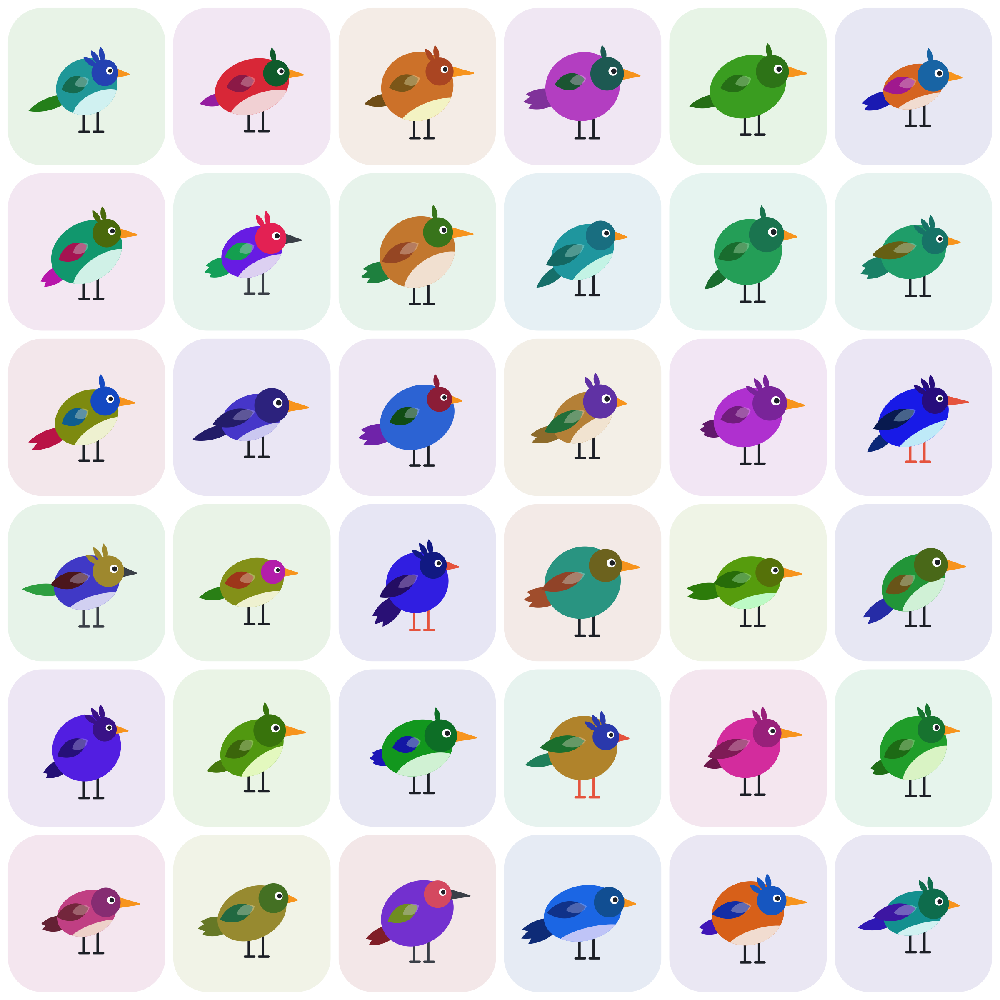

# zorvinkel-bird-avatars

Deterministic bird avatars as SVG. A seed yields a 19-byte, versioned *spec*; the spec renders to a songbird in side view (body, head, beak, eye, wing, tail, legs, optional crest and belly). No dependencies, no unsafe code, no randomness at render time.

Developed for [Zorvinkel](https://github.com/), where a device stores its avatar spec once and every client renders it identically. The library is independent of Zorvinkel and usable on its own.



## Usage

```toml
[dependencies]
zorvinkel-bird-avatars = { git = "https://github.com/<owner>/zorvinkel-bird-avatars" }
```

```rust
use zorvinkel_bird_avatars::{AvatarSpec, render_svg};

let spec = AvatarSpec::from_seed(42);
let hex = spec.to_hex();                       // store this
let spec = AvatarSpec::from_hex(&hex).unwrap();
let svg = render_svg(&spec, "avatar-1");       // 200×200 SVG tile
```

`render_svg` takes an id prefix so several avatars can share one SVG document or HTML page without id collisions.

## Guarantees

- **Stable format:** `AvatarSpec::encode` writes a version byte followed by one byte per trait. Rendering of a version stays visually stable; a changed look needs a new `SPEC_VERSION`. Store the spec, not the seed.
- **Total:** every byte pattern decodes to a valid, finite SVG.
- **Readable:** lightness of each part is adjusted so that body, head, wing and tail keep at least 3:1 contrast against the background and neighboring parts stay distinguishable (WCAG 2 contrast ratios, checked in the tests for thousands of seeds).
- **Distinct:** 20,000 consecutive seeds yield 20,000 different specs.

## Development

```bash
cargo test
cargo run --example gallery -- gallery.svg 36   # contact sheet
```

## License

GPL-3.0-or-later, see [LICENSE](LICENSE).
